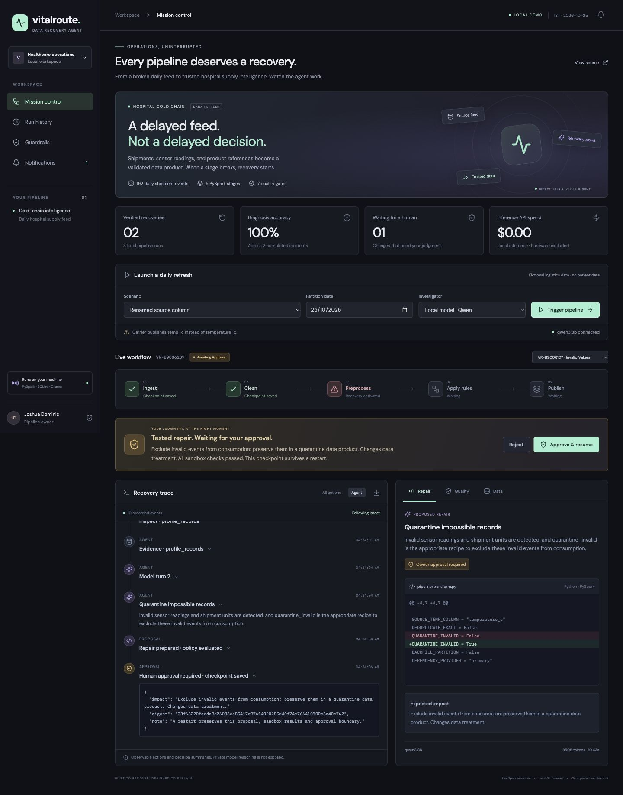
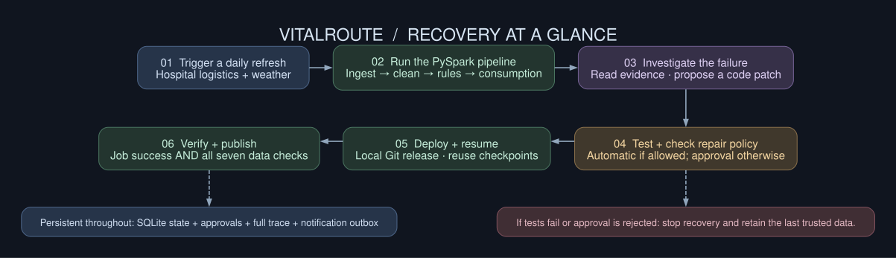

<p align="center"><strong>V I T A L R O U T E</strong><br/>Data Pipeline Recovery Agent</p>

# A broken feed should not become a blind spot.

A hospital supply dashboard is only useful when the data arrives intact. A renamed column, replayed event, or unavailable dependency can stop the daily pipeline—and leave the team deciding from yesterday's numbers.

**VitalRoute investigates the failure, edits a bounded PySpark transformation, tests the repair, gets approval when needed, and resumes the workflow. Recovery means the data checks pass, too.**



## Watch a recovery

1. Choose **Renamed source column** and click **Trigger pipeline**.
2. Ingestion succeeds; cleaning stops on a real missing-column check.
3. The local Qwen agent reads the code, calls diagnostic tools, and proposes an evidence-backed Python diff.
4. A separate Spark sandbox runs the candidate through all five stages and seven quality gates.
5. Policy permits the contracted alias. The agent creates a real local Git commit and deploys its immutable code artifact.
6. The failed stage and downstream stages resume. Only verified data is published, and a recovery notification is queued.

Then choose **Product registry unavailable**. The candidate passes its tests, but changing a dependency pauses for **Approve & resume**. Restart the app while it waits: the proposal and approval boundary survive.

## Run it for free

```bash
make setup
make start
```

Open [localhost:8180](http://127.0.0.1:8180). Use **Runbook · deterministic** immediately, or install [Ollama](https://ollama.com/) and pull `qwen3:8b` for local model-led investigation. No paid model, database, scheduler, or cloud account is required. [Setup, daily refresh, Gmail, and evaluation](docs/setup.md).

## The data story

A daily fictional hospital cold-chain feed contains **192 shipment events**, four facilities, three products, temperature readings, inventory quantities, and expiry dates. Date-partitioned batches change each day. Optional [Open-Meteo](https://open-meteo.com/) forecasts add fresh public ambient-weather context, with provenance saved in each manifest.

**Ingest → clean → preprocess → apply domain rules → prepare consumption data.** All tabular work uses PySpark. The final Parquet product includes cold-chain holds, usable inventory, expiry risk, and shipment features for reports, APIs, or ML. Invalid records are retained in quarantine after approval. No patient data or clinical decisions are involved.

## Autonomy with clear boundaries

| Injected failure | Repair | Control |
|---|---|---|
| Renamed temperature column | Use a documented Celsius alias | Automatic after sandbox |
| Duplicate connector replay | Remove fully identical events | Automatic; conflicting versions block |
| Missing daily partition | Replay verified same-date landing data | Automatic after checksum verification |
| Impossible sensor/quantity values | Quarantine records; retain an audit ledger | Human approval: data treatment |
| Product registry unavailable | Switch to a verified, version-matched mirror | Human approval: dependency change |

The model proposes; code enforces. Whole-module AST checks reject edits outside reviewed recipes. Approval binds to the tested code and input digest. Architecture changes, new dependencies, arbitrary code, and altered business thresholds stop for owner investigation. A generic approval cannot unlock unsupported edits.

## What is real here?

| Capability | Delivery |
|---|---|
| PySpark execution, injected failures, sandbox tests, checkpoint reuse | Real local execution |
| Local model tool calls, evidence, code diffs, latency, token usage | Recorded live; explicit runbook mode also available |
| Tested code commit and release | Real per-incident local Git repository; no automatic GitHub push |
| Approval, trace, idempotency, notification state | Persistent SQLite WAL |
| Recovery verification | Seven data gates: counts, uniqueness, freshness, required fields, source validity, business rules, event conservation |
| Email | Durable outbox by default; Gmail OAuth adapter when app-owned credentials are configured |
| Databricks-hosted failure task, GitHub/CI/bundle promotion and repair | Integration reference and plan generator; cloud deployment not provisioned or verified |

## Architecture



**React + TypeScript** renders recorded events from **FastAPI**. A durable Python recovery state machine controls **PySpark**, **SQLite**, **Ollama**, and a notification outbox. The coding tool materializes a reviewed patch; it never executes unrestricted model text. [Architecture and control boundaries](docs/architecture.md).

The production mapping follows **Databricks job failure → hosted recovery notebook → isolated test → policy/approval → GitHub commit/PR → CI → bundle deployment → repair failed tasks → data verification**. Included notebooks, bundle definitions, and a plan-only CLI make the handoff inspectable. Identity-backed cloud approval/promotion and workspace validation remain integration work. [Databricks guide](docs/databricks.md).

## Evidence

```bash
make test
make lint
make evaluate
python3 scripts/run.py evaluate --mode ollama --output artifacts/ollama-evaluation.json
```

Tests exercise all five failures with actual Spark, restart-safe approval, rejected/stale decisions, input tampering, patch scope, idempotency, and unchanged healthy output. Evaluations compare against known causes and record verified recovery, unnecessary changes, latency, tokens, and local inference API cost. The evaluation owner explicitly approves gated test candidates; normal dashboard runs wait for the operator. [Recorded verification](docs/verification.md).

This is a production-shaped local portfolio demonstration, not an unattended production service. Raw data, credentials, runtime databases, local repair repositories, and generated releases stay outside Git.
