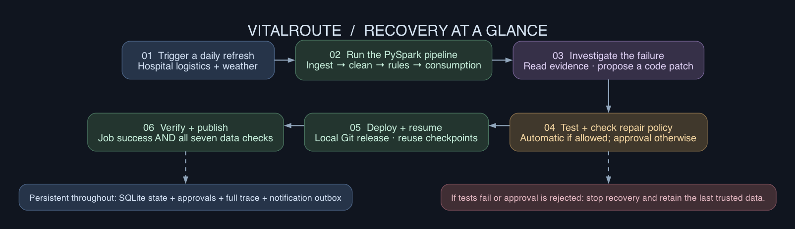
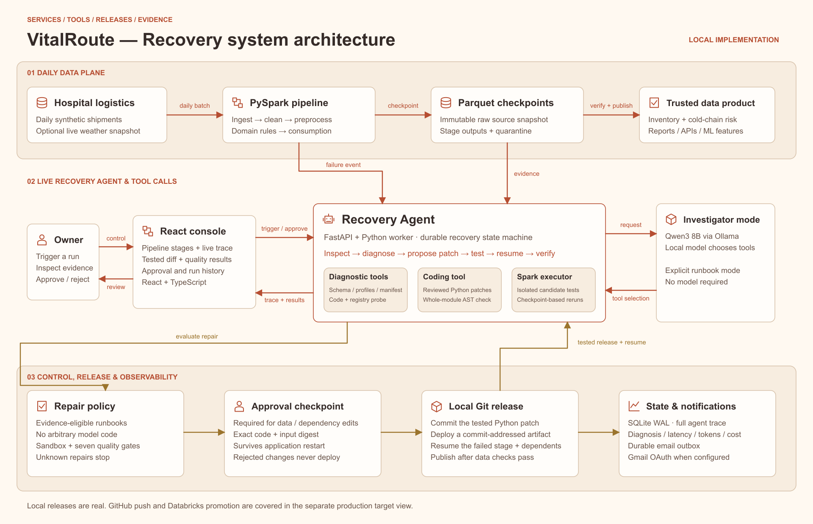

# Architecture

The application is a small durable state machine around a real PySpark job. It uses SQLite rather than a cloud orchestrator for the local control plane; the data plane is date-partitioned JSON and Parquet. React displays recorded events from the API every 1.5 seconds. FastAPI handles control requests while a single background worker serializes Spark jobs.



The short flow preserves the original dark palette and groups recovery into six steps. Editable overview sources: [Mermaid](diagrams/architecture.mmd), [Graphviz](diagrams/architecture.dot), and [SVG](diagrams/architecture.svg).

## Services, tools and controls



This copper-and-ivory system view follows the service-and-arrow structure of the AgilePlanner architecture while showing VitalRoute's own data plane, recovery tools, approvals and local release controls. [Scalable SVG](diagrams/recovery_system.svg).

The separate [Databricks production flow](databricks.md#production-flow) describes the target cloud handoff. Both service diagrams are generated from [render_diagrams.py](../scripts/render_diagrams.py); the SVG exports are editable vector files. Run `make diagrams` with Graphviz and `rsvg-convert` (librsvg) installed to rebuild all three views. These rendering tools are needed only for documentation changes.

## Data product

| Stage | Actual operation | Output |
|---|---|---|
| Ingestion | Verify immutable landing checksum, partition availability and manifest count | Raw shipment checkpoint |
| Cleaning | Map contracted temperature column, trim facility names, optionally remove exact connector replays | Unique canonical events |
| Preprocessing | Cast dates, validate source ranges and optionally quarantine invalid events | Accepted events + quarantine ledger |
| Business rules | Join product catalogue, evaluate demonstration cold-chain/expiry rules, calculate usable units and risk | Enriched shipment decisions |
| Consumption | Select features and validate downstream invariants | Parquet for reports, backend APIs, or ML |

Cold-chain breaches remain in the data product with `hold_for_review` and zero usable units. Implausible values can be quarantined only after approval; they are never silently clipped or imputed. The system does not make medical decisions, and its thresholds are fictional demo rules.

## Recovery lifecycle

```text
queued → running → failure → investigating → testing
                                 ↓           ↓
                              blocked    approval required?
                                           ↙     ↘
                                  auto-allowed   awaiting_approval
                                           ↘     ↙ approved
                                            applying → verifying → recovered
                                                          ↓
                                                       blocked
```

Healthy runs finish as `succeeded` without invoking an agent or editing code. Rejection finishes as `rejected`. Unknown failures and unsupported edits stop as `blocked` rather than forcing a repair.

The model sees the actual failure and read-only diagnostic tools. It does not receive the injected scenario name. Its tool calls, observations, concise rationale, token usage, and latency are persisted as observable evidence. Private reasoning is not exposed. The evaluator alone compares the diagnosed cause against the known injection.

## Policy and approvals

| Repair | Guard | Approval |
|---|---|---|
| Temperature alias | Exact documented Celsius alias; canonical name absent | Automatic after sandbox |
| Replay deduplication | Fully identical rows; no conflicting event versions | Automatic after sandbox |
| Partition replay | Same-day landed snapshot with matching checksum | Automatic after sandbox |
| Quarantine | Small bounded set of impossible source values, retained in a ledger | Required: changes data treatment |
| Registry mirror | Available mirror, same catalogue version/content | Required: changes dependency |

The agent edits a real Python module using versioned repair recipes. An AST comparison permits only the selected setting and rejects every other code change. The repaired module is then executed by Spark. This deliberately bounds the demo's coding autonomy. Architectural changes, new libraries, arbitrary code, source-value invention, and business-threshold edits have no executable recipe, even with a generic approval.

Candidate code and source snapshot hashes form the proposal digest. A decision applies only to that exact digest and pending state. Before deployment, the engine rechecks the full patch, hashes, and approval requirement. The local operator identity is a demo label, not an enterprise authentication system.

## Isolation and publication

Sandbox output is separate from production output, against the same raw snapshots. This is data/output isolation inside a trusted local process, not an OS sandbox for arbitrary model code. The policy rejects arbitrary code before execution.

Each incident creates a small Git repository under its ignored runtime directory. It commits the baseline and actual tested repair, then copies the code to a commit-addressed release directory with a checksum manifest. This neither modifies the application's source checkout nor pushes recovery commits to GitHub. Every injected incident starts with the faulty baseline so demos remain repeatable.

After deployment, successful upstream Parquet checkpoints are reused. The failed task and downstream tasks run again. Validation checks row counts, duplicate IDs, exact partition date, required fields/product joins, plausible values, business-rule outputs, and event conservation including quarantine. Only a passing report advances the atomic `published.json` pointer. A failed release leaves the prior pointer intact; candidate artifacts are retained for investigation. Partial Parquet directories are not public data products.

## Persistence and practical limits

SQLite WAL stores runs, ordered events, proposals, approvals, idempotency keys, and notification outbox records. Writes are serialized in process, and an OS file lock prevents a second worker against the same state directory. Restarted active runs re-enter from saved state; waiting approvals remain waiting. A crash between a completed stage and checkpoint acknowledgement may replay that stage safely. The current implementation replays the original pipeline if failure state was not persisted, then resumes repairs from the failed stage once it has evidence.

This is a single-user loopback application. Host/origin checks and an operator token protect mutations against cross-site requests. Bootstrap is readable by local applications; it is not a remote authentication boundary. Do not expose this server publicly. Production requires authenticated users, authorization, distributed leases, durable transactional approval/outbox storage, an isolated executor, access-controlled data snapshots, and protected deployment credentials.
