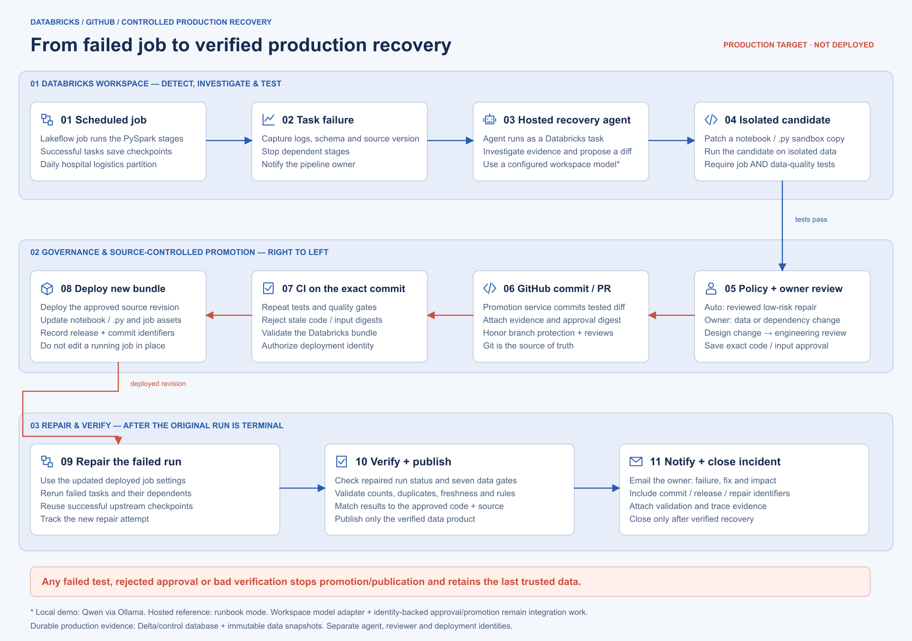

# Databricks production mapping

The free local demonstration executes the full recovery loop. The Databricks files are a workspace integration reference, not a deployment that has been run or validated against a workspace. No Databricks account, compute, volume, model endpoint, cloud job, or deployment credential is provisioned by local setup.

## Production flow



The agent runs inside Databricks, tests an isolated notebook/Python patch, and hands the verified change to an authorized source-control and deployment service. The diagram follows the target handoff through GitHub, CI, bundle deployment, repaired tasks and data verification. [Scalable SVG](diagrams/databricks_production.svg) · [Concrete scenario in the README](../README.md#how-this-would-run-in-production-on-databricks).

## Intended production sequence

1. A scheduled Lakeflow job runs the five PySpark stages. Successful stages save checkpoints to a Unity Catalog volume.
2. A Databricks-hosted recovery notebook runs with `AT_LEAST_ONE_FAILED` dependencies. It reads the failure evidence, inspects data/code, proposes a bounded patch, and runs a sandbox test.
3. The proposal and test evidence are saved durably. Dependency and data-treatment changes wait for an identity-backed approval of the exact code/input digest. The notebook exits while waiting; it does not keep a cluster running to poll a human.
4. A trusted promotion service applies the tested diff in a clean Git checkout at a checked base SHA, creates a GitHub commit/PR, and attaches the evidence. Branch protections still apply. Recovery code is never edited only in an ephemeral workspace notebook.
5. CI tests that exact commit, validates the bundle and deploys it using a separate deployment identity. The running agent does not gain arbitrary repository or workspace write access.
6. After the original run is terminal, the service repairs the failed task and dependent tasks. It verifies the repaired attempt and a fresh downstream report with the approved code/source hashes before declaring recovery and emailing the owner.

Databricks documents [task failure conditions](https://docs.databricks.com/aws/en/jobs/run-if), [repairing failed runs](https://docs.databricks.com/aws/en/jobs/repair-job-failures), and [bundle deployment](https://docs.databricks.com/aws/en/dev-tools/cli/bundle-commands). Repair uses the current job settings and is a multi-task job operation. A successful notebook alone does not prove data recovery.

## Included reference files

| File | Responsibility |
|---|---|
| `tools/databricks/databricks.yml` | Five staged notebook tasks, a failure-triggered hosted recovery task, failure email, serialized runs, paused dev triggers |
| `tools/databricks/notebooks/stage.py` | Run exactly one stage using the same PySpark executor and shared checkpoints |
| `tools/databricks/notebooks/recovery_agent.py` | Use the deterministic investigator on Databricks, test a candidate, save proposal and Delta event evidence |
| `tools/promotion_plan.py` | Validate a tested local incident/approval and print the corresponding GitHub/bundle/repair plan; **never executes cloud actions** |
| `.github/workflows/ci.yml` | Manual-only CI for Spark tests, frontend build, and deterministic evaluation; no automatic hosted minutes, cloud deployment, or Gmail sends |

The hosted reference uses runbook investigation because a local Ollama process is not reachable inside a Databricks workspace. Connecting a workspace model endpoint requires a provider adapter and an explicit budget. The local Qwen mode is the tested LLM agent experience.

Required integration work before real deployment: provision a compatible cluster and UC volume; validate notebook import/file behavior for the chosen Databricks runtime; implement the identity-backed approval and promotion service; store approvals/outbox in transactional Delta tables or a control database; configure GitHub and Databricks service identities and Gmail secrets; test actual job repair and rollback. The local SQLite store must not be placed on a distributed volume as a production control database. The supplied hosted notebook persists proposal files and Delta evidence, but does not implement that missing approval/promotion service.

## Review a plan locally

After a dashboard recovery, substitute its real run ID and the intended Databricks run ID:

```bash
PYTHONPATH=src .venv/bin/python tools/promotion_plan.py \
  --incident VR-YOURRUNID --databricks-run-id 123456
```

The plan identifies `tools/databricks` as the working directory for bundle commands; the promotion service must use that directory in the reviewed checkout. This emits argv arrays for `bundle validate`, `bundle deploy`, and `jobs repair-run`, alongside required identity and verification boundaries. The numeric ID above is illustrative and no command is sent. Repeated repairs must use the current `latest_repair_id` from the job's repair history to prevent stale concurrent repair requests. See the [repair API](https://docs.databricks.com/api/workspace/jobs/repairrun).

## Workspace validation, when an account is available

```bash
cd tools/databricks
databricks bundle validate -t dev \
  --var cluster_id=YOUR_EXISTING_CLUSTER,data_root=/Volumes/YOUR_CATALOG/YOUR_SCHEMA/YOUR_VOLUME
```

The bundle synchronizes only `src/` and its reference notebooks, preserving their repository paths. See the official [bundle sync configuration](https://docs.databricks.com/aws/en/dev-tools/bundles/reference#syncpaths) for paths outside the bundle directory. Runtime state, local environments, and frontend dependencies are outside these sync paths.

Only deploy after reviewing compute cost, permissions, test results, and workspace configuration. Databricks charges depend on the account/compute offering; the project does not assume paid Databricks is free. The local demo requires no Databricks subscription.
